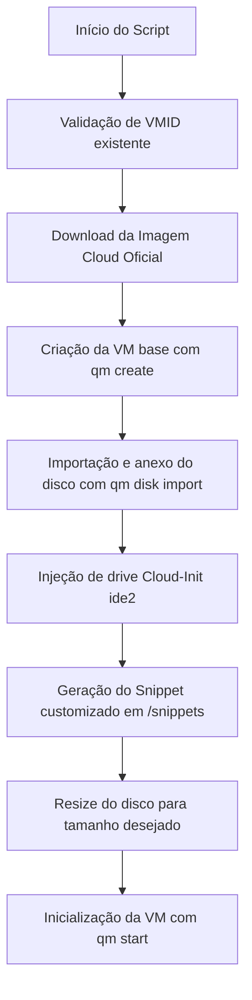

# 🐧 Proxmox VM Cloud-Init Automation

Script interativo em Bash para provisionamento automatizado e instantâneo de Máquinas Virtuais no **Proxmox VE (PVE)** via linha de comando (CLI), utilizando imagens oficiais **Cloud-Init** sem necessidade de templates manuais ou interface gráfica.

---

## 🚀 Funcionalidades

- **Provisionamento On-Demand:** Criação rápida de VMs sem necessidade de criar ou clonar templates manualmente na Web GUI.
- **Múltiplas Distribuições Suportadas:**
  - 🟠 **Ubuntu 22.04 LTS** (Jammy Jellyfish)
  - 🔴 **Debian 12** (Bookworm)
  - 🔵 **CentOS Stream 9**
  - 🟡 **Oracle Linux 9** (UEK / Red Hat Compatible)
- **Download Inteligente de Imagens:** Baixa automaticamente as imagens cloud oficiais (`.img` / `.qcow2`) para `/var/lib/vz/template/iso` apenas se o arquivo ainda não existir localmente.
- **Customização Automática com Cloud-Init:**
  - Criação dinâmica do snippet de configuração (`#cloud-config`) em `/var/lib/vz/snippets/`.
  - Configuração de usuário customizado ou padrão do SO (`ubuntu`, `debian`, `cloud-user`, `opc`).
  - Habilitação automática de privilégios `sudo NOPASSWD` e autenticação SSH via senha/chave.
  - Definição automática de hostname e reinicialização dos serviços SSH da VM.
- **Validação de Recursos:**
  - Checagem de ID da VM (`VMID`) para evitar conflito com instâncias já existentes.
  - Conversão transparente de parâmetros de hardware (RAM de GB para MB, cores de CPU, expansão de disco via `qm resize`).
  - Configuração otimizada para virtualização KVM (controlador SCSI `virtio-scsi-pci`, rede em bridge `vmbr0`, `qemu-guest-agent` habilitado).

---

## 🛠️ Tecnologias e Requisitos

- **Hipervisor:** Proxmox VE 7.x ou 8.x
- **Linguagem:** Shell Script (Bash)
- **Ferramentas do Proxmox:** `qm`, `pvesm`
- **Utilitários do Host:** `wget`, `grep`, `cat`
- **Storage Padrão:** `local-lvm` (ou ajustável no script)
- **Bridge de Rede:** `vmbr0`

---

## 📂 Estrutura do Repositório

```text
script-proxmox-criaVMcloud-init/
├── cria-vm-prox.sh       # Script principal de automação e provisionamento
└── README.md             # Documentação completa do projeto
```

---

## ⚙️ Como Utilizar no Proxmox VE

### 1. Download do Script no Host Proxmox

Acesse o terminal do seu servidor Proxmox (via SSH ou Console Web) e baixe o script:

```bash
# Baixar o script
wget -O cria-vm-prox.sh https://raw.githubusercontent.com/igorpaiva26/script-proxmox-criaVMcloud-init/main/cria-vm-prox.sh

# Conceder permissão de execução
chmod +x cria-vm-prox.sh
```

---

### 2. Execução Interativa

Execute o script com permissões de root:

```bash
./cria-vm-prox.sh
```

O assistente solicitará os seguintes dados passo a passo:
1. **VMID:** ID numérico único para a nova VM (o script valida e impede IDs duplicados).
2. **Nome da VM:** Identificador legível (ex: `web-server-01`).
3. **Memória RAM:** Quantidade em Gigabytes (ex: `2` para 2 GB).
4. **Cores de CPU:** Quantidade de núcleos dedicados (ex: `2`).
5. **Tamanho do Disco:** Capacidade em Gigabytes (ex: `20` para 20 GB).
6. **Distribuição:** Escolha entre Ubuntu, Debian, CentOS ou Oracle Linux.
7. **Usuário e Senha:** Credenciais administrativas que serão injetadas pelo Cloud-Init.

---

### 3. O que o Script faz nos bastidores:



Após a inicialização, a VM obterá IP via DHCP na rede local e estará pronta para acesso SSH imediato:
```bash
ssh usuario@ip-da-vm
```

---

## 👤 Autor

Desenvolvido por **[Igor Paiva](https://github.com/igorpaiva26)**.
